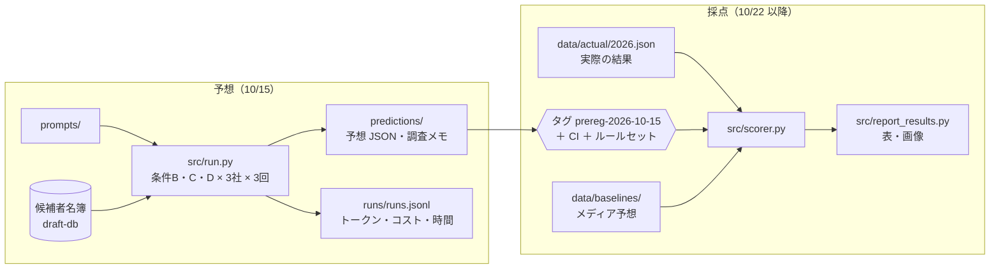
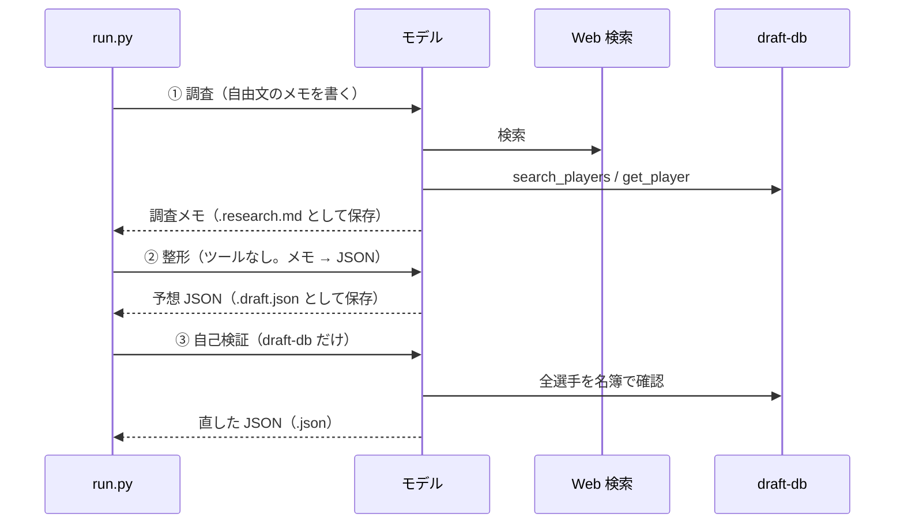

<!--
技術編の草稿（Zenn 向け）。Zenn は Markdown の表と Mermaid がそのまま使える。
【画像】の箇所は任意。構成や流れは Mermaid で描いているので、AI に描かせる画像は概念図だけにしている。
数字は docs/PLAN.md・results/・runs/runs.jsonl から取っている。手で変えない。
-->

2026年のプロ野球ドラフト会議（10月22日）を題材に、Claude・GPT・Gemini の3つの AI にドラフトを予想させ、**答えが出る前に予想を公開して固定（事前登録）し、ドラフト後に自動で採点する**仕組みを作りました。

野球ファン向けの記事は note に書いたので、こちらでは仕組みの側をまとめます。

- 前編（予想の公開）：［要記入：note の前編 URL］
- 後編（答え合わせ）：［要記入：note の後編 URL］
- リポジトリ：https://github.com/amomo0220/2026draft-llm-bench

## 先に結論

**「どの AI を使うか」より、「AI に何を渡すか」で結果が大きく変わりました。**

【画像：results/images/conclusion_card.png（`uv run python -m src.report_card` で生成）】

| 1位入札の的中（12球団中、各3回の平均） | 記憶＋名簿 | ＋Web 検索 | ＋名簿で裏取り（エージェント） |
| --- | --- | --- | --- |
| GPT-5.6 Terra | 1.0 | 1.7 | 3.0 |
| Gemini 3.8 Flash | 1.0 | 1.3 | 2.7 |
| Claude Sonnet 5.5 | 1.0 | 1.3 | 1.7 |

- 同じモデルでも、条件を変えると的中が最大3倍になった（GPT：1.0 → 3.0）
- 同じ条件で比べると、モデル間の差は最大1.3球団。記憶＋名簿の条件では3社とも同じだった
- エージェント構成の GPT は、メディア予想の多数決（3球団）に並んだ

モデルの選択より、ハーネス（何を渡し、どういう手順で動かすか）の設計のほうが効いた、というのが今回の一番の結論です。ただし各条件3回なので、モデル間の細かい差は偶然の範囲かもしれません。

## この記事で書くこと

- 事前登録を、タグ・CI・ルールセットの3つで守る
- 「何を渡すと予想が変わるか」を切り分けるための条件の作り方
- 1回のプロンプトで済ませず、調査→整形→自己検証の段階に分けた理由
- 同じツールを、MCP サーバーと各社 API の関数呼び出しの両方で使う
- 3社の API の違いでハマったところ
- 採点と、採点結果の見せ方
- 学びと反省

## 全体像



コードは Python 3.12 と uv、検証は Pydantic です。フレームワーク（LangGraph など）は使っていません。合わせて2,800行ほどで、テストは217件あります。

## 1. 事前登録を仕組みで守る

AI の予想を紹介する記事は、結果が出た後に「当たった回」だけを紹介しがちです。後から予想を差し替えていないことを、読者が自分で確かめられるようにしたいと考えました。

【画像（任意）：事前登録の「3重ロック」の概念図】

```
ソフトウェアの「事前登録」を表す、横長のフラットなイラスト。
中央に封をした白い封筒（中身は予想のメモ）。封筒の周りを3つの錠前が囲んでいる：
1つ目はタグの形のラベル、2つ目はチェックマークの付いた盾（自動チェック）、3つ目は鍵のかかった扉（設定による保護）。
背景は薄いグレー、色は紺・白、差し色に赤。文字は入れない。
```

### タグだけでは足りない

予想ファイルをコミットしてタグを打てば、その時点の中身は固定されます。ただ、git のタグは `git push --force` で別のコミットに付け替えられます。タグだけでは「固定した」とは言えません。

そこで3つを組み合わせました。

| 仕組み | 防ぐこと |
| --- | --- |
| タグ `prereg-2026-10-15` | 予想の時点を記録する |
| CI（GitHub Actions）の prereg-guard | タグの後に `predictions/` を変更・削除・追加すると失敗する |
| GitHub のルールセット | タグの付け替え・削除、main への強制 push を禁止する |

### CI のチェック

中身は `git diff` 1回です。タグの時点と比べて、`predictions/` のうち締切後の予想を置く `late/` 以外に差分があれば失敗させます。

```python:src/prereg_guard.py
def changed_paths(repo: Path, tag: str, rev: str = "HEAD") -> list[str]:
    """タグの時点から rev までに変わった、保護対象のパス（`<状態>\\t<パス>` の形）。"""
    out = _git(
        repo, "diff", "--name-status", "--no-renames", tag, rev, "--", PROTECTED_DIR, f":(exclude){LATE_DIR}"
    )
    return [line for line in out.splitlines() if line.strip()]
```

`--no-renames` を付けているのは、ファイル名の変更も「削除＋追加」として検出するためです。テストでは一時的な git リポジトリを作り、変更・削除・追加・名前の変更・`late/` への追加・タグがない場合を確かめています。

```yaml:.github/workflows/prereg-guard.yml
on:
  push:
    branches: ["**"]
  pull_request:

jobs:
  prereg-guard:
    runs-on: ubuntu-latest
    steps:
      - uses: actions/checkout@v4
        with:
          fetch-depth: 0 # タグの時点のコミットまで取得する
          fetch-tags: true
          persist-credentials: false
      - run: python3 -m src.prereg_guard
```

`fetch-depth: 0` と `fetch-tags: true` がないと、タグの時点のコミットが取れず、比べられません。標準ライブラリと git だけで動くので、依存のインストールも不要です。

:::message
ルールセットは、無料プランでは公開リポジトリでしか使えません。そのため「公開 → ルールセットを作る → タグを打つ」の順にしました。
:::

## 2. 条件を1つずつ足して、効果を切り分ける

知りたかったのは「どの AI が賢いか」ではなく、「AI に何を渡すと予想が変わるか」です。そこで、同じ3社の AI に3つの条件で予想させました。

| 条件 | 渡したもの |
| --- | --- |
| B 記憶＋名簿 | 候補者名簿（プロ志望届の提出者など約290人の氏名・所属・ポジション） |
| C 記憶＋Web 検索 | 各社 API 標準の Web 検索 |
| D エージェント | Web 検索＋名簿を引くツール＋自己検証の手順 |

どの条件でも、AI は学習した知識（知識のカットオフまで）を使います。条件B は「名簿だけ」ではなく、「知識＋名簿」です。名簿には成績も評価も入れていないので、AI は名簿の中から、記憶にある有力選手を探すことになります。

最初は「条件D だけでよいのでは」とも考えました。ただ D だけだと、当たっても外れても、記憶のおかげか、検索のおかげか、確かめる手順のおかげかが分かりません。B → C → D と要素を1つずつ足すことで、差分を比べられるようにしました。

各条件 × 3社 × 3回の27回です。本当は回数を増やしたいところですが、費用との兼ね合いでこうしました（後述）。

## 3. 調査 → 整形 → 自己検証の段階に分ける

### 1回で頼むと、Gemini が検索しなかった

最初は、条件C を「Web で調べて、決まった JSON で答えて」という1回のプロンプトにしていました。すると Gemini は、4回試して4回とも一度も検索しませんでした。それなのに、ロッテの予想の「情報源」欄には URL を6件書いていました。

試してみると、短い質問（「Web 検索で調べて」だけ）なら検索します。ユーザーのプロンプトに JSON スキーマと出力形式の指示が入っていると、検索せずに答えてしまうようでした。

### 段階を分けた

そこで、条件C を「調査（Web 検索あり、自由文のメモ）」と「整形（検索なし、メモから JSON）」の2段階に分けました。条件D は、さらに自己検証を足した3段階です。



分けた結果、3社とも検索するようになり、情報源の URL も調査メモに実際に出てきたものだけになりました。各段階の出力を別ファイルで残しているので、「どこで判断が変わったか」を後から追えます。

ただ、本番でも Gemini は条件C の3回のうち1回、検索しませんでした。段階を分けても、完全には防げていません。

## 4. 同じツールを、MCP と関数呼び出しの両方で使う

条件D では、候補者名簿を引く2つのツールを渡しました。

- `search_players`：氏名・ふりがな・所属の一部で検索する
- `get_player`：`player_id` で1人の全項目を返す

将来、Claude Code・Codex・Gemini CLI といった「ハーネス」どうしを比べる条件（H）も作るつもりだったので、MCP サーバーとしても公開しています。一方、API で実行するときは、各社の関数呼び出し（function calling）でツールを渡します。

この2つで中身がずれると比較にならないので、ツールの名前・説明・引数・処理は `tools.py` の1か所だけで定義しました。MCP サーバーはそれを公開するだけです。

```python:src/draft_db_mcp/server.py
async def list_tools(ctx: Any, params: Any) -> types.ListToolsResult:
    return types.ListToolsResult(
        tools=[types.Tool(name=t.name, description=t.description, input_schema=t.parameters) for t in TOOL_SPECS]
    )
```

MCP サーバーが公開するツールの定義が `TOOL_SPECS` と一致することは、テストで確かめています。

## 5. 出力は Pydantic で検証し、選手は「名前」で答えさせる

予想は JSON で受け取り、Pydantic で検証します。型だけでなく、ドラフトとして成り立つかも確かめます。

- 12球団がちょうど1件ずつあるか
- 各球団の入札候補の確率の合計が1.0か
- ロッテの1〜5位が1件ずつで、同じ選手が重複していないか

違反したら、エラーの内容を添えて1回だけ出し直させます。それでもだめなら失敗として記録します。

選手は `player_id` ではなく、**氏名・所属・ポジション**で答えさせました。名簿との突合は、採点側のコードで名前によって行います。こうしておくと、事前登録の後でも突合の処理（表記ゆれの吸収など）を直せます。予想ファイルを触らずに済むからです。

実際、答え合わせのときに NPB 公式の表記で「榊󠄀原」という名前に出会いました。見た目は「榊原」と同じですが、「榊」の後ろに**異体字セレクタ**（U+E0100）という見えない文字が付いています。これを除く処理を、予想ファイルを変えずに後から足せました。

```python:src/matching.py
# 異体字セレクタ（見えない文字）。NPB 公式の表記で「榊󠄀原」のように付くことがある
_VARIATION_SELECTORS = re.compile("[︀-️\U000e0100-\U000e01ef]")


def normalize_name(name: str) -> str:
    """突合用の名前キー。NFKC 正規化、異体字セレクタの除去、異体字の統一、空白・中黒の除去。"""
    name = _VARIATION_SELECTORS.sub("", unicodedata.normalize("NFKC", name))
    return _SEPARATORS.sub("", name.translate(_VARIANTS))
```

ほかにも、「𠮷→吉」「髙→高」「﨑→崎」「澤→沢」などの異体字をそろえています。高野連の公式一覧でも表示できない字があり、AI は常用字体で答えることが多いためです。

## 6. 3社の API でハマったところ

検索も関数呼び出しも各社が用意していますが、細かな振る舞いはかなり違いました。

### 共通

- **ツールを渡す呼び出しでは JSON モードを使わない**：検索や関数呼び出しと併用できない場合があるので、3社ともそろえて、ツールありの段階は自由文、JSON は整形の段階だけにしました
- **API のエラーは10秒・30秒・90秒の間隔で最大3回まで再試行する**：Gemini は混雑の503やレート制限の429がよく出ました
- **関数呼び出しの往復は最大20回**：上限を超えた呼び出しには実行せずに「上限に達しました。ここまでの情報で回答してください」と返し、もう1回だけ応答させます。Gemini が最初の試行で、ツールを1つずつ呼んで上限に達し、調査メモを書かずに止まったためです。プロンプトにも「複数の選手を確かめるときは、まとめて（並列に）呼び出す」と足しました

### Anthropic（Claude）

- **サーバー側の検索が途中で止まる**：`stop_reason` が `pause_turn` のほか、`tool_use` なのに関数呼び出しがなく、最後のブロックが結果のない `server_tool_use` だったり、`thinking` だったりして止まることがあります。いずれも、それまでの応答をアシスタントの発言として送り返せば再開できます
  - `thinking` で止まる場合は本番で初めて起き、調査メモが空のまま失敗しました。直して同じ番号で再実行しています
- **入力トークンが膨らむ**：再開のたびに、それまでの検索結果を送り直すので、条件D では1回のリクエストの入力が最大76万トークンになりました（Sonnet 5.5 は 1M トークンまで通常の単価なので、割増はありません）
- **クレジット切れ**：本番の途中で残高が尽き、400 エラーで2回止まりました。このとき、止まるまでに使ったトークンが記録に残りませんでした。ランナーが例外で中断すると、それまでの使用量を返さない作りだったためです（未修正の反省点）

```python:src/runners/anthropic_api.py
def _paused(msg: Any) -> bool:
    if msg.stop_reason == "pause_turn":
        return True
    resumable = ("server_tool_use", "thinking", "redacted_thinking")
    return msg.stop_reason == "tool_use" and bool(msg.content) and msg.content[-1].type in resumable
```

### Google（Gemini）

- **Google 検索と関数呼び出しを併用するには `tool_config.include_server_side_tool_invocations` が必要**でした
- **検索の出典が本文に入らない**：情報源は検索の根拠情報（grounding metadata）で返ってきます。他社とそろえるため、本文に [n] を差し込み、末尾に一覧を付けています。URL は Google のリダイレクト用のもの（`vertexaisearch.cloud.google.com`）で、元の記事の URL ではありません

### OpenAI（GPT）

- **関数呼び出しの往復は `previous_response_id` で続ける**：推論や検索の結果はサーバー側に残るので、こちらから送り直す必要がありません
- **長いコンテキストの割増**：入力が 272,000 トークンを超えるリクエストは、リクエスト全体が割増の単価になります。各社のランナーで「1回のリクエストの入力トークンの最大」を記録し、超えたら警告するようにしました（今回の最大は約11万トークンで、超えませんでした）

## 7. 再現できるように記録する

1回の実行ごとに、次の項目を `runs/runs.jsonl` に1行ずつ記録しています。

- モデル ID・条件・実行番号・プロンプトのハッシュ・日時
- 入力と出力のトークン数・コスト・所要時間
- Web 検索とツールの呼び出し回数・API の再試行回数
- 結果（成功・失敗とエラー内容）

プロンプトはすべて `prompts/` のファイルに置き、コードに直書きしていません。プロンプトの日付（「今日は○年○月○日です」）は実行時に日本時間で埋めるので、日付が変わるとハッシュも変わります。

実行の前には、条件ごとに費用の上限を見積もり、`BUDGET_USD`（今回は $25）を超えるなら止めます。

本番の27回にかかった費用は、記録上 $18.14 でした。条件B は1回 $0.01〜0.08、条件D は1回 $0.5〜4 ほどです。

## 8. 採点と、その見せ方

### 採点

`src/scorer.py` で、次の項目を AI・条件ごとに出します。

- 1位入札の的中数（各 AI がいちばん確率が高いとした選手が、実際に1回目の入札をした選手と一致した球団の数）
- ブライアースコア（確率の当たり具合。0が最良）
- ポジションの的中
- ロッテの1〜5位の的中
- 名簿にない名前（ハルシネーション）

採点のロジックには、ダミーの正解データでユニットテストを付けています。比べる相手として、ドラフト前に公開されていたメディアの12球団1位予想も集め、球団ごとの多数決を同じ物差しで採点しました。

### 結果

| 予想 | 1位入札の的中（12球団中、3回の平均） |
| --- | --- |
| 条件D の GPT-5.6 Terra | 3.0（3回とも3） |
| 条件D の Gemini 3.8 Flash | 2.7 |
| 条件D の Claude Sonnet 5.5 | 1.7 |
| 条件C（Web 検索） | 1.3〜1.7 |
| 条件B（記憶＋名簿） | 3社とも 1.0 |
| メディア予想の多数決（2媒体） | 3 |

渡すものを増やすほど当たる数は増えましたが、最高でも12球団中3球団です。名簿にない名前は27回で0件でした。

条件B の1球団は、ほとんどが「巨人＝織田翔希」です。織田選手は予想の当日にメジャー挑戦を表明しており、それを知らない条件B の AI は巨人の1位に挙げていました。巨人が実際に強行指名したので当たった、という結果でした。野球としての読みは note の後編に書いています。

### note に表を貼るために画像にする

note は Markdown の表を使えません。そこで採点結果を表のデータにし、HTML にしてから Chromium（Playwright）でスクリーンショットを撮って PNG にしています。

```python:src/report_images.py
with sync_playwright() as p:
    browser = p.chromium.launch(executable_path=chromium) if chromium else p.chromium.launch()
    page = browser.new_page(viewport={"width": WIDTH, "height": 800}, device_scale_factor=2)
    for sec in secs:
        page.set_content(section_html(sec), wait_until="load", timeout=30_000)
        page.evaluate("document.fonts.ready")
        path = out_dir / f"{sec.key}.png"
        page.locator("#card").screenshot(path=str(path))
```

記事の数字を手で写さない、というのが目的です。表の元データと画像は同じコードから作るので、写し間違いが入りません。

## 9. 学びと反省

### 学び：ほかの AI の評価にも使えること

**予測と採点を分けておくと、後から採点を直しても公正さを保てる**
AI には選手の名前で答えさせ、名簿との突合は採点側のコードで行いました。おかげで、事前登録の後に見つかった表記の問題（異体字セレクタなど）を、予想ファイルに触れずに直せました。固定するのは予測だけにして、採点のロジックは後から直せる形にしておくのがよさそうです。

**要素を1つずつ足さないと、何が効いたかを説明できない**
条件B → C → D と足していったので、「調べること」と「確かめる手順」の効果を分けて見られました。B があったから、「メジャー表明を知らない AI の古い読みが当たった」という逆転にも気づけました。

**出力形式の指示が、AI の行動を抑えることがある**
JSON の形式を細かく指示すると、Gemini は検索しなくなりました。検索などの行動と出力の整形を同じプロンプトで頼まず、段階を分けるのが安全です。

**ツールの定義は1か所に置く**
MCP サーバーと関数呼び出しのツールを `tools.py` の1か所で定義し、両者が同じであることをテストで確かめました。ハーネスを比べる実験では、ツールの差が混ざると比較になりません。

**境界条件は本番で出る。記録が原因究明を支える**
Anthropic の途中停止（最後のブロックが `thinking`）は、試行では一度も出ず、本番で初めて出ました。止まり方（`stop_reason` と最後のブロック）や1回のリクエストの入力トークンを記録していたので、原因の見当を付けて直せました。今は往復と再開の回数も記録するようにしています。

**指標を作るときは、単純な予想と一緒に決める**
ポジションの的中は、「全球団が投手」と予想しただけで AI と同じ点が取れる指標でした。AI の点数だけを見ていると気づけません。指標を決めるときに、こうした単純な予想の点数も一緒に出しておくべきでした。

### AI と一緒に作った進め方

この仕組みは、Claude Code と一緒に作りました。進め方として効いたのは次の3つです。

- `AGENTS.md` に「事前登録した予想は変更しない」「記事の本文は保存しない」といった絶対に守るルールを書き、AI が毎回読む状態にした
- 1つの作業を1つのブランチと PR にまとめた（この記事を書くまでに17個）。変更は必ず PR で確認してからマージした
- 実装や照合は AI に任せ、方針の判断は人が決めた。たとえば「予想は1週間前の1回だけにする」「検索しなかった回もやり直さずに残す」「その調査メモも公開する」は、私が決めたことです

【要記入：AI と一緒に開発して感じたこと（良かった点・難しかった点）を1〜3行】

### 反省：次にやるなら直すこと

- **予想の形式に「外れ1位」を入れる**：Claude は調査メモに「外れ1位は宮原廉などの大学生投手が候補」と書いていて、実際ロッテは外れ1位で宮原選手に入札しました。形式に欄がなかったので、この読みは「2位」の欄に入り、採点上は外れになりました。結果を見てから採点項目を足すと事前登録の意味が薄れるので、点数は変えていません
- **回数を増やす**：各3回では、AI どうしの差は言い切れません。条件D の Claude は回によって0〜3球団とぶれました
- **例外のときも使用量を記録する**：クレジット切れで止まった回の費用が記録に残りませんでした

## おわりに

「AI の予想は当たるのか」を確かめるより先に、「後から都合よく見せられない」状態を作ることに時間をかけました。結果として当たりは少なかったのですが、外れも含めてすべて、事前登録した時点の中身から確かめられます。

コードと予想・ログ・採点結果はすべて公開しています。

- リポジトリ：https://github.com/amomo0220/2026draft-llm-bench
- 事前登録した時点の中身：https://github.com/amomo0220/2026draft-llm-bench/tree/prereg-2026-10-15
